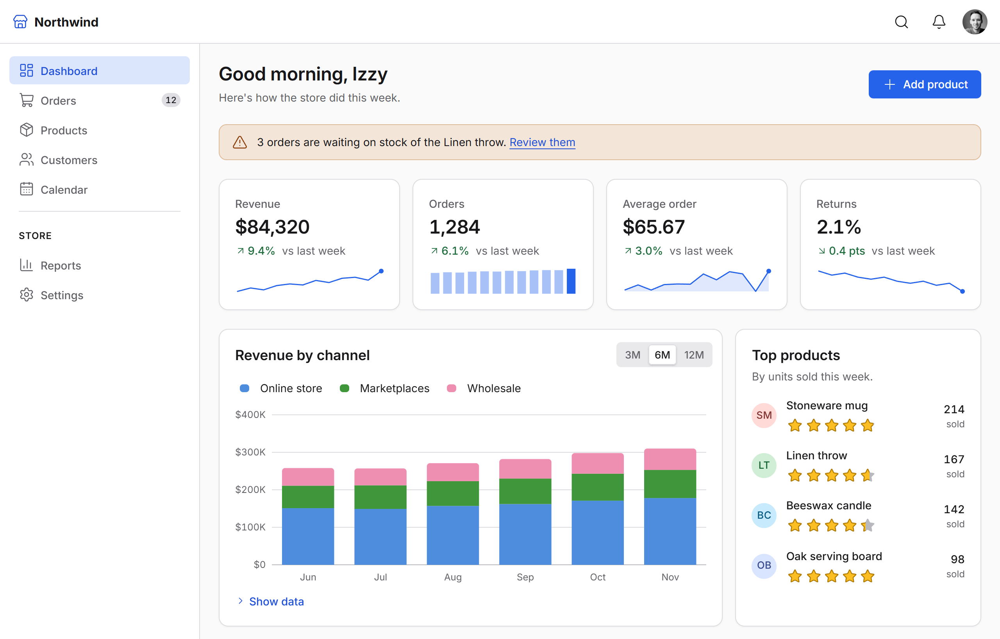

<h1 align="center">
  <picture>
    <source media="(prefers-color-scheme: dark)" srcset="brand/github/readme-banner-dark.svg">
    
  </picture>
</h1>

<p align="center"><strong>Interactive in every render mode, even static SSR.</strong></p>

Most Blazor components need a server circuit or a WebAssembly download to be interactive. IzzyBlazor's
components are interactive in every render mode, even static SSR.

IzzyBlazor is an open-source library of 170+ components for .NET 10 and later: forms, data grids, charts,
scheduling, dialogs and complete app layouts.

## Interactivity shouldn't need a circuit or a download

- **Interactive Server uses memory for every tab.** Every tab on an Interactive Server page holds a circuit in
  your server's memory.
- **WebAssembly makes users wait.** The browser downloads the .NET runtime before the page can respond, which
  is slow on phones.
- **A dropped connection stalls the page.** When a circuit drops, a reconnect overlay covers the page. If it
  can't reconnect, anything typed into a form is lost.

On static pages, IzzyBlazor's components render as HTML and handle clicks, typing and keyboard navigation in
the browser, with no circuit to keep open and no runtime to download. Pages respond as soon as they load. When
a page needs C#, move it to Interactive Server, WebAssembly or Auto: the same components bind to C# with
events and two-way binding, and behave the same way.

[Explore the components](https://izzyblazor.com/docs/components) · [Get started](https://izzyblazor.com/docs/get-started/create-app)

<picture>
  <source media="(prefers-color-scheme: dark)" srcset="docs/images/showcase-dark.png">
  
</picture>

> **Status:** preview (`0.1.0-alpha.25`). APIs may change during preview.

## Built for every render mode

The same components work in static SSR, Interactive Server, WebAssembly and Auto. On a static page, URLs,
forms and the browser's own elements do the work; on an interactive page, C# events and binding do.

| | Static | Interactive |
| --- | --- | --- |
| **What runs** | Server-rendered HTML, with IzzyBlazor's script adding browser behavior. No circuit, no WebAssembly | Server, WebAssembly or Auto: Blazor events keep C# in sync |
| **Dialog** | Opens from a link (`?dialog=id`) and closes with a form; focus handling and backdrop click | `@bind-Open` |
| **Table** | Sorts, filters and pages through the URL; select-all, filters as you type | Sorting, paging, filters and selection bound to C# |
| **Tabs** | ARIA tabs with arrow keys, over radio buttons and CSS | `@bind-Selected` |
| **Combobox** | A native select that posts with the form, with type-to-filter and keyboard navigation | Server-side search as you type |
| **FileUpload** | The file posts with the form (`IFormFile`); drop files on the zone, type and size checked first | `OnChange` streams `IBrowserFile`s |

Every page starts as working HTML: before IzzyBlazor's script loads, and while an interactive page prerenders. So
nothing is broken while a page wakes up.

Interactive Server pages hold a SignalR circuit, as in any Blazor app. ReconnectDialog, the one component made
for that connection, shows its state when it drops.

## Get a running app in three steps

IzzyBlazor is in preview, so name the latest version from NuGet.

1. **Create the app.** The starter is Microsoft's Blazor Web App rebuilt with IzzyBlazor, with the same options
   as `dotnet new blazor`: any render mode, and sign-in if you need it.

   ```bash
   dotnet new install IzzyBlazor.Templates@<version>
   dotnet new starter-blazor -n MyApp
   ```

   For an app you already have (a Blazor Web App, or an MVC or Razor Pages app), run `izzy init` in it instead:

   ```bash
   dotnet tool install -g IzzyBlazor.Cli --prerelease
   izzy init
   ```

2. **Build your pages.** Use the components in your pages, and generate a grid page for any model when you
   need one:

   ```bash
   izzy add crud Product
   ```

3. **Ship it.** Deploy wherever ASP.NET Core runs. Static pages need no open connection, so they scale like any
   website.

To make each setup change yourself, see [Set up by hand](https://izzyblazor.com/docs/get-started/by-hand).

### Free with an account

A [free account](https://izzyblazor.com/pricing) adds six app starters, 15 page blocks and Izzy CRM, a complete
sample app, all generated on your machine as code you own (`izzy login`, then `izzy add hero`). You don't need
an account for the components, the docs or the starter above.

## What's included

170+ components, in the same groups as the docs:

- **Layout:** Box, Row, Column, Stack, Grid, Container, PageHeader, SectionHeader, Section, Center, Spacer, Divider, TileLayout, Splitter, AppShell (header, collapsible sidebar, aside, footer), AppSidebar
- **Typography:** Heading, TextBlock, Prose, RichText, Markdown, Anchor, Code (with syntax highlighting), Diff, CodeExample, Blockquote, Kbd, Highlight
- **Buttons:** Button, IconButton, ButtonGroup, ToggleButton, ToggleGroup, SplitButton, FloatingButton, SpeedDial, Toolbar, ConfirmButton, CopyButton
- **Inputs:** Form, Fieldset, FieldRepeater, FieldFrame, TextField (with masks and add-ons), PasswordField, TextArea, RichTextEditor, Mentions, NumberField, PinField, Checkbox, CheckboxGroup, Switch, RadioGroup, SegmentedControl, PickList, Slider, RangeSlider, Rating, ColorPicker, ColorPanel, FileUpload
- **Date and time:** DateField, TimeField, DateRangeField, MultiDateField, MonthField, YearField, DurationField, Calendar
- **Dropdowns:** Select, Combobox, Autocomplete, MultiSelect, TreeSelect, MultiTreeSelect
- **Overlays:** Dialog (and DialogService), ConfirmDialog, ActionSheet, Drawer, Menu, ContextMenu, Popover, Tooltip
- **Navigation:** SiteNav, NavMenu, Tabs, TabNav, Breadcrumb, Pagination, PrevNext, OnThisPage, Stepper
- **Disclosure:** Accordion, Collapsible, ShowMore
- **Feedback:** Alert, Banner, Toast, Spinner, Progress, ProgressCircle, Skeleton, EmptyState
- **Data:** FilterBuilder, FilterForm, Table, DataGrid (filtering, grouping, editing, column menus, frozen columns, export), TreeList, ListView, DropZoneGroup, Kanban, TreeView, Scheduler
- **Display:** Icon (all of Lucide, plus brand logos), Card, Stat, Avatar, AvatarGroup, Badge, Tag, Timeline, Barcode, QrCode, List, DescriptionList
- **Media:** AspectRatio, Image, BrowserFrame, VideoEmbed, Carousel, Lightbox
- **Conversation & AI:** Chat, Comment, MentionText
- **Charts:** bar, line, area, range bar and area, scatter, bubble, histogram, box plot, violin, candlestick, OHLC, waterfall, pie and donut, nested donut, funnel, heatmap, calendar heatmap, radar, Sankey, treemap, BulletChart, Sparkline, Gauge, LinearGauge, with zoom, drill-down, live data and a RangeSelector; drawn on the server as SVG
- **Utilities:** IzzyTheme, ThemeScope, ColorSchemeSwitch, RelativeTime, VisuallyHidden, ReconnectDialog, LiveRegion, ErrorGuard

Build responsive layouts and apply theme tokens through typed component props. If you've used
Chakra UI or Mantine, the layout props will feel familiar:

```razor
<Stack Direction="new() { Base = Direction.Column, Md = Direction.Row }" Gap="4">
    <Box Padding="6" Bg="Color.Fill" Radius="Radius.Lg" Grow>...</Box>
    <Button StartIcon="Lucide.Plus">New order</Button>
</Stack>
```

Light and dark themes are built in, and a single part of the page (a dark sidebar, say) can use its
own scheme.

## Accessibility

Components build to WCAG 2.2 level AA on the browser's own elements, with keyboard support, visible
focus (in Windows high-contrast mode too), names screen readers read, and announcements for changes.
The [Accessibility docs](https://izzyblazor.com/docs/accessibility/overview) list how it's checked and
the gaps that remain.

## Documentation

**[izzyblazor.com](https://izzyblazor.com)** includes live component examples, render-mode guidance, and API documentation.

- [Getting started](https://izzyblazor.com/docs/get-started/create-app): setup, packages and render modes
- [Pricing](https://izzyblazor.com/pricing): what's open, what a free account adds, and Pro
- [Components](https://izzyblazor.com/docs/components): examples, mode support and API for each
- [Style props](https://izzyblazor.com/docs/common/style-props) and [Theming](https://izzyblazor.com/docs/theming): responsive values, colors, tokens and themes
- [Accessibility](https://izzyblazor.com/docs/accessibility/overview): standards, keys for every component, and testing your app
- [Contributing](CONTRIBUTING.md): repository layout, the dev host and adding a component

## Browser support

IzzyBlazor requires a modern browser with support for CSS `:has()`, `light-dark()`, and the Popover
API. Older browsers without these features are not supported.

## Issues and pull requests

Bug reports and feature requests are welcome as [issues](https://github.com/enabledevmode/izzyblazor/issues).
The project doesn't take pull requests for now.

## License

MIT. Bundled Lucide icons are ISC licensed; the brand logos (from Tabler Icons, plus a few drawn for
IzzyBlazor) are MIT licensed; the bundled Inter font is under the SIL Open Font License. See
[THIRD-PARTY-NOTICES.md](THIRD-PARTY-NOTICES.md).

The starters, blocks and kits that come with an IzzyBlazor account are not MIT. Their templates are not in this
repository, and the code generated from them is yours to use in any app under the
[IzzyBlazor Template License](LICENSE-TEMPLATES), which also covers the block previews and pictures the docs site
keeps here (`site/IzzyBlazor.Site/Blocks/Previews`, `wwwroot/img/blocks`, `wwwroot/img/templates`). The
`blazor` starter and the grid page of `izzy add crud` are MIT.

IzzyBlazor is an independent project and is not affiliated with Microsoft.
