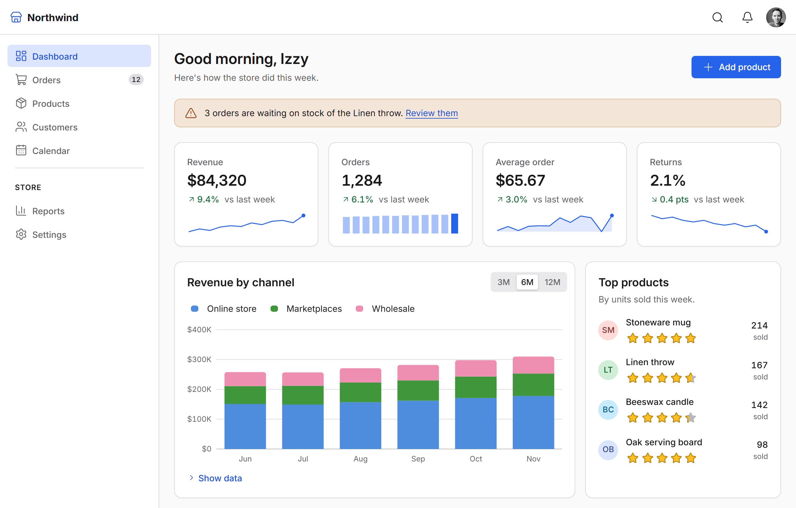

<h1 align="center">
  <picture>
    <source media="(prefers-color-scheme: dark)" srcset="brand/github/readme-banner-dark.svg">
    
  </picture>
</h1>

<p align="center">Rich components for static SSR. C# interactivity when you need it.</p>

IzzyBlazor is a component library for .NET 10 Blazor Web Apps, built for static SSR. Components
render as HTML on the server, gain browser behavior through lightweight custom elements, and
support C# bindings and events on interactive pages.

Build forms, data grids, charts, scheduling, dialogs and complete app layouts—without requiring a
SignalR circuit or WebAssembly runtime for static pages.

[Explore the components](https://izzyblazor.com/docs/components) · [Get started](https://izzyblazor.com/docs/get-started)

<picture>
  <source media="(prefers-color-scheme: dark)" srcset="docs/images/showcase-dark.png">
  
</picture>

> **Status:** preview (`0.1.0-alpha.22`). APIs may change during preview.

## Static and Interactive

The same components work in both of Blazor's render modes. Start static; make a page interactive when it needs C#.

| | Static | Interactive |
| --- | --- | --- |
| **What runs** | Server-rendered HTML, with IzzyBlazor's script adding browser behavior. No circuit, no WebAssembly | Server, WebAssembly or Auto: Blazor events keep C# in sync |
| **Dialog** | Opens from a link (`?dialog=id`) and closes with a form; focus handling and backdrop click | `@bind-Open` |
| **Table** | Sorts, filters and pages through the URL; select-all, filters as you type | Sorting, paging, filters and selection bound to C# |
| **Tabs** | ARIA tabs with arrow keys, over radio buttons and CSS | `@bind-Selected` |
| **Combobox** | A native select that posts with the form, with type-to-filter and keyboard navigation | Server-side search as you type |
| **FileUpload** | The file posts with the form (`IFormFile`); drop files on the zone, type and size checked first | `OnChange` streams `IBrowserFile`s |

Every page starts as working HTML: before IzzyBlazor's script loads, and while an interactive page prerenders. So
nothing is broken while a page wakes up.

## Getting started

Install the package in your server project:

```bash
dotnet add package IzzyBlazor --prerelease
```

Then add the stylesheet and the namespace, and register the services:

```razor
@* App.razor, in <head> *@
<link rel="stylesheet" href="@Assets["_content/IzzyBlazor.Core/izzyblazor.css"]" />

@* _Imports.razor *@
@using IzzyBlazor
```

```csharp
// Program.cs
builder.Services.AddIzzyBlazor();
```

IzzyBlazor loads its JavaScript automatically. For toasts and screen reader announcements, add `<ToastRegion />` to your layout (or `<AnnouncerRegion />` for announcements alone). For WebAssembly and
Auto render modes, see [WebAssembly and Auto](https://izzyblazor.com/docs/get-started/webassembly-and-auto).

## What's included

More than 140 components, in the same groups as the docs:

- **Layout:** Box, Row, Column, Stack, Grid, Container, Section, Center, Spacer, AspectRatio, Divider, Splitter
- **App shell:** AppShell (header, collapsible sidebar, aside, footer), AppSidebar, SiteNav, IzzyTheme, ThemeScope, ColorSchemeSwitch
- **Typography:** Heading, TextBlock, List, Prose, RichText, Markdown, Anchor, Code (with syntax highlighting), Diff, CodeExample, Blockquote, Kbd, Highlight, Icon (all of Lucide, plus brand logos)
- **Actions:** Button, IconButton, ButtonGroup, ToggleButton, ToggleGroup, SplitButton, FloatingButton, SpeedDial, Toolbar, ConfirmButton, CopyButton
- **Forms:** Form, Fieldset, FieldFrame, FilterBuilder, FilterForm
- **Inputs:** TextField (with masks and add-ons), PasswordField, RichTextEditor, TextArea, NumberField, Slider, RangeSlider, Rating, PinField, ColorPanel, ColorPicker, FileUpload
- **Date and time:** DateField, TimeField, DateRangeField, MultiDateField, MonthField, YearField, Calendar, DurationField
- **Selection:** Select, Combobox, Autocomplete, MultiSelect, TreeSelect, MultiTreeSelect, PickList, Checkbox, Switch, RadioGroup, CheckboxGroup, SegmentedControl
- **Overlays:** Dialog (and DialogService), Drawer, Menu, ContextMenu, Popover, Tooltip, ReconnectDialog
- **Navigation:** NavMenu, Tabs, TabNav, Breadcrumb, Pagination, PrevNext, OnThisPage, Stepper, Carousel, Accordion, Collapsible
- **Feedback:** Alert, Banner, Toast, LiveRegion, Badge, Tag, Spinner, Progress, ProgressCircle, Skeleton, EmptyState
- **Data:** Table, DataGrid (filtering, grouping, editing, column menus, frozen columns, export), ListView, DropZoneGroup, DescriptionList, TreeView, Scheduler
- **Display:** Card, Stat, Avatar, AvatarGroup, Image, VideoEmbed, Timeline, Chat, Barcode, QrCode
- **Charts:** bar, line, area, scatter, bubble, waterfall, pie and donut, nested donut, funnel, heatmap, calendar heatmap, radar, Sankey, treemap, Sparkline, Gauge, with zoom, drill-down, live data and a RangeSelector; drawn on the server as SVG

Build responsive layouts and apply theme tokens through typed component props. If you've used
Chakra UI or Mantine, the layout props will feel familiar:

```razor
<Stack Direction="new() { Base = Direction.Column, Md = Direction.Row }" Gap="4">
    <Box Padding="6" Bg="Color.Fill" Radius="Radius.Lg" Grow>...</Box>
    <Button StartIcon="Lucide.Plus">New order</Button>
</Stack>
```

Light and dark themes are built in, and a single part of the page (a dark sidebar, say) can use its
own scheme.

## Accessibility

Components build to WCAG 2.2 level AA on the browser's own elements, with keyboard support, visible
focus (in Windows high-contrast mode too), names screen readers read, and announcements for changes.
The [Accessibility docs](https://izzyblazor.com/docs/accessibility/overview) list how it's checked and
the gaps that remain.

## Documentation

**[izzyblazor.com](https://izzyblazor.com)** includes live component examples, render-mode guidance, and API documentation.

- [Getting started](https://izzyblazor.com/docs/get-started): setup, packages and render modes
- [Components](https://izzyblazor.com/docs/components): examples, mode support and API for each
- [Style props](https://izzyblazor.com/docs/common/style-props) and [Theming](https://izzyblazor.com/docs/theming): responsive values, colors, tokens and themes
- [Accessibility](https://izzyblazor.com/docs/accessibility/overview): standards, keys for every component, and testing your app
- [Contributing](CONTRIBUTING.md): repository layout, the dev host and adding a component

## Browser support

IzzyBlazor requires a modern browser with support for CSS `:has()`, `light-dark()`, and the Popover
API. Older browsers without these features are not supported.

## Issues and pull requests

Bug reports and feature requests are welcome as [issues](https://github.com/enabledevmode/izzyblazor/issues).
The project doesn't take pull requests for now.

## License

MIT. Bundled Lucide icons are ISC licensed; the brand logos (from Tabler Icons, plus a few drawn for
IzzyBlazor) are MIT licensed; the bundled Inter font is under the SIL Open Font License. See
[THIRD-PARTY-NOTICES.md](THIRD-PARTY-NOTICES.md).
IzzyBlazor is an independent project and is not affiliated with Microsoft.
