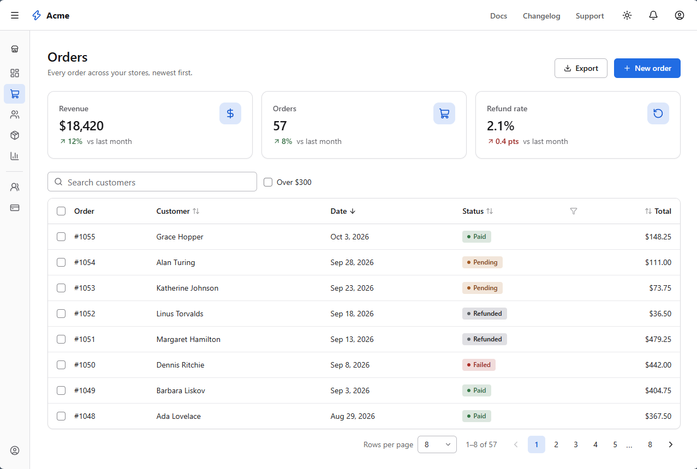

<h1 align="center">
  <picture>
    <source media="(prefers-color-scheme: dark)" srcset="brand/github/readme-banner-dark.svg">
    
  </picture>
</h1>

<p align="center">Works in static SSR. No SignalR or WebAssembly needed.</p>

IzzyBlazor is a component library for .NET 10 Blazor Web Apps, built for static server rendering
first. Every component renders complete, working HTML on the server, even with JavaScript off, gets
better when scripts run, and binds to C# on interactive pages.

<picture>
  <source media="(prefers-color-scheme: dark)" srcset="docs/images/showcase-dark.png">
  
</picture>

> **Status:** preview (`0.1.0-alpha.3`). The API will change before 0.1.

**Browsers:** current Chrome, Edge, Firefox and Safari, from 2024 on. IzzyBlazor relies on CSS
`:has()`, `light-dark()` and the Popover API; older browsers aren't supported.

## Every component works three ways

| | With JavaScript off | With JavaScript | On interactive pages |
| --- | --- | --- | --- |
| **How** | Plain HTML, forms, links and CSS | Small custom elements add polish | Blazor events keep C# in sync |
| **Dialog** | Opens from a link (`?dialog=id`), closes with a form | Focus handling, backdrop click | `@bind-Open` |
| **Table** | Sort and page through links in the URL | Same, without full reloads | Navigates through Blazor |
| **Tabs** | Radio buttons and CSS switch panels | Proper ARIA tabs, roving focus | `@bind-Selected` |
| **Combobox** | A native select that posts with the form | Type to filter, keyboard navigation | Server-side search as you type |
| **FileUpload** | The file input posts with the form (`IFormFile`) | Drop files anywhere on the zone; type and size checked first | `OnChange` streams `IBrowserFile`s |

The same component works on a static page, an enhanced one, or an interactive island, and you don't
choose a different component for each.

## What's included

- **Layout:** Box, Stack, Row, Column, Grid, Container, Center, Spacer, Divider, AspectRatio, Section
- **App structure:** AppShell (header, collapsible sidebar, aside, footer, content width), AppBrand, NavMenu,
  HeaderNav
- **Typography:** TextBlock, Heading, Anchor, Code (with syntax highlighting), Kbd, List, Prose, Icon
  (all of Lucide, plus brand logos)
- **Actions:** Button, LinkButton, IconButton, ButtonGroup, ConfirmButton
- **Forms:** Form, TextField (with add-ons), TextArea, NumberInput, Slider, Select, Combobox,
  MultiSelect, Checkbox, CheckboxGroup, Switch, RadioGroup, SegmentedControl, ColorPicker, FileUpload,
  Fieldset, FilterForm
- **Overlays and disclosure:** Menu, Popover, Tooltip, Dialog (and DialogService), Drawer, Accordion, Collapsible
- **Navigation:** Tabs, Stepper, Breadcrumb, Pagination
- **Feedback:** Alert, Banner, Badge, Tag, Toast, Spinner, Progress, Skeleton, EmptyState
- **Data and media:** Card, Table, Stat, DescriptionList, Timeline, Avatar, AvatarGroup, Image,
  VideoEmbed
- **Theming:** IzzyTheme (presets, brand color, grays, fonts), ColorSchemeSwitch

Styling is typed and responsive, through props on the components, with no CSS to write and nothing
computed at runtime. If you've used Chakra UI or Mantine, the layout props will feel familiar:

```razor
<Stack Direction="new() { Base = Direction.Column, Md = Direction.Row }" Gap="4">
    <Box Padding="6" Bg="Color.SurfaceContainer" Radius="Radius.Lg" Grow>...</Box>
    <Button StartIcon="Lucide.Plus">New order</Button>
</Stack>
```

Light and dark themes are built in, and a single part of the page (a dark sidebar, say) can use its
own scheme.

## Getting started

Install the package in your server project:

```bash
dotnet add package IzzyBlazor --prerelease
```

Then add the stylesheet and the namespace, register the services and map the endpoints:

```razor
@* App.razor, in <head> *@
<link rel="stylesheet" href="@Assets["_content/IzzyBlazor.Core/izzyblazor.css"]" />

@* _Imports.razor *@
@using IzzyBlazor
```

```csharp
// Program.cs
builder.Services.AddIzzyBlazor();
// after app.MapRazorComponents<App>():
app.MapIzzyBlazor();
```

The JavaScript loads itself. For toasts, add `<ToastRegion />` to your layout. For WebAssembly and
Auto render modes, see [Getting started](docs/getting-started.md#webassembly-and-auto-render-modes).

## Documentation

- [Getting started](docs/getting-started.md): setup, packages and render modes
- [Styling](docs/styling.md): style props, responsive values, colors, tokens and themes
- [Components](docs/components.md): what each component does in each mode
- [Contributing](CONTRIBUTING.md): repository layout, the dev host and adding a component

## Issues and pull requests

Bug reports and feature requests are welcome as [issues](https://github.com/enabledevmode/izzyblazor/issues).
The project doesn't take pull requests for now.

## License

MIT. Bundled Lucide icons are ISC licensed; the brand logos (from Tabler Icons, plus a few drawn for
IzzyBlazor) are MIT licensed; the bundled Inter font is under the SIL Open Font License. See
[THIRD-PARTY-NOTICES.md](THIRD-PARTY-NOTICES.md).
IzzyBlazor is an independent project and is not affiliated with Microsoft.
