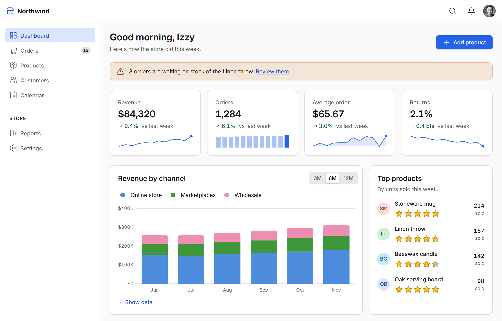

# IzzyBlazor

**Blazor components. No circuit required.**

IzzyBlazor is a component library for .NET 10 and .NET 11 Blazor apps in every render mode: Interactive Server, WebAssembly, Auto, and static SSR. Components render as HTML on the server and bind to C# on interactive pages. On static pages they gain browser behavior through lightweight custom elements, with no SignalR circuit or WebAssembly runtime.

Choose each page's render mode for what the page needs, not for what your component library can handle. Build forms, data grids, charts, scheduling, dialogs, and complete app layouts with the same components on every page.

More than 140 components: layout and app shell, inputs, date and time fields, selection, overlays, navigation, feedback, Table and DataGrid, TreeView, Scheduler, Chat, a rich text editor, and fourteen chart types drawn on the server as SVG. They build to WCAG 2.2 level AA, with keyboard support, visible focus in high-contrast mode, and announcements for screen readers.

[Explore the components](https://izzyblazor.com/docs/components) · [Get started](https://izzyblazor.com/docs/get-started)



> **Preview:** `0.1.0-alpha.23`. APIs may change during preview.

## Static and Interactive

The same components work in all of Blazor's render modes, static or interactive, so you choose each page's mode for what that page does.

| Component | Static | Interactive |
| --- | --- | --- |
| **Dialog** | Opens from a trigger or a `?dialog=id` link; server-opened dialogs become modal | Bind open state with `@bind-Open` |
| **Table** | Sort, filter, and page through URL parameters; select all rows, filter as you type | Bind sorting, paging, filters, and selection to C# |
| **Tabs** | ARIA tabs with arrow-key navigation, over radio buttons and CSS | Bind the selected tab with `@bind-Selected` |
| **Combobox** | A native select that submits with the form, with filtering and keyboard navigation | Search on the server as you type |
| **FileUpload** | Submits files with the form as `IFormFile`, with drag and drop and type and size checks | Stream `IBrowserFile` instances through `OnChange` |

Every page starts as working HTML: before IzzyBlazor's script loads, and while an interactive page prerenders. So nothing is broken while a page wakes up.

## Getting started

Install the package in your server project:

```bash
dotnet add package IzzyBlazor --prerelease
```

Add the stylesheet in `App.razor`:

```razor
@* Inside <head> *@
<link rel="stylesheet" href="@Assets["_content/IzzyBlazor.Core/izzyblazor.css"]" />
```

Add the namespace in `_Imports.razor`:

```razor
@using IzzyBlazor
```

Register the services in `Program.cs`:

```csharp
builder.Services.AddIzzyBlazor();
```

IzzyBlazor loads its JavaScript automatically. To display toasts and screen reader announcements, add `<ToastRegion />` to your layout (or `<AnnouncerRegion />` for announcements alone).

For WebAssembly and Auto render modes, reference `IzzyBlazor.Core` in your `.Client` project and call `AddIzzyBlazorCore()`. See the [WebAssembly and Auto setup guide](https://izzyblazor.com/docs/get-started/webassembly-and-auto) for details.

## Documentation

Visit **[izzyblazor.com](https://izzyblazor.com)** for live component examples, render-mode guidance, and API documentation.

- [Getting started](https://izzyblazor.com/docs/get-started): installation and setup
- [Components](https://izzyblazor.com/docs/components): examples, supported modes, and APIs
- [Style props](https://izzyblazor.com/docs/common/style-props): typed, responsive styling
- [Theming](https://izzyblazor.com/docs/theming): colors, fonts, and theme configuration
- [Accessibility](https://izzyblazor.com/docs/accessibility/overview): standards, keyboard support, and known gaps
- [Source and issues](https://github.com/enabledevmode/izzyblazor): browse the code and report bugs

## Browser support

Requires a modern browser with support for CSS `:has()`, `light-dark()`, and the Popover API.

## License

IzzyBlazor is [MIT licensed](https://github.com/enabledevmode/izzyblazor/blob/main/LICENSE).

Bundled Lucide icons use the ISC license. Brand logos from Tabler Icons and those drawn for IzzyBlazor use the MIT license. The bundled Inter font uses the SIL Open Font License. See [third-party notices](https://github.com/enabledevmode/izzyblazor/blob/main/THIRD-PARTY-NOTICES.md) for details.

IzzyBlazor is an independent project and is not affiliated with Microsoft.
